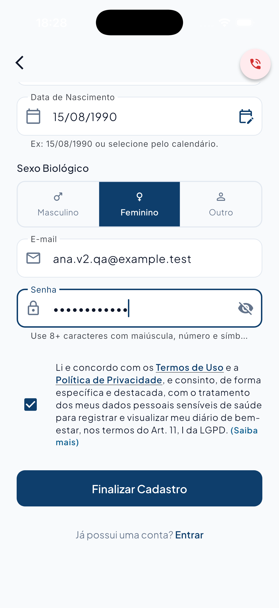
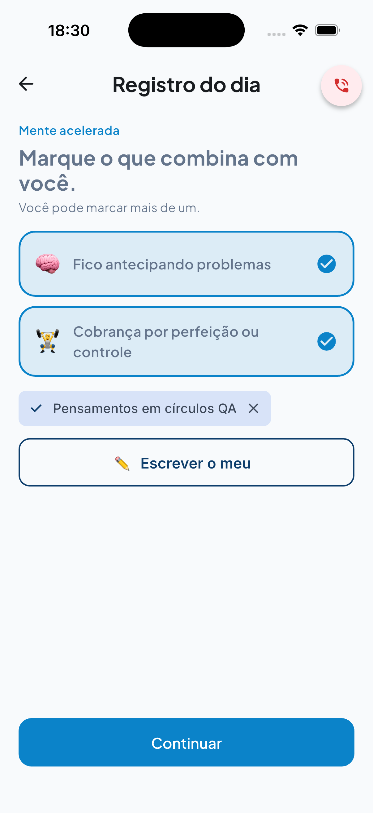
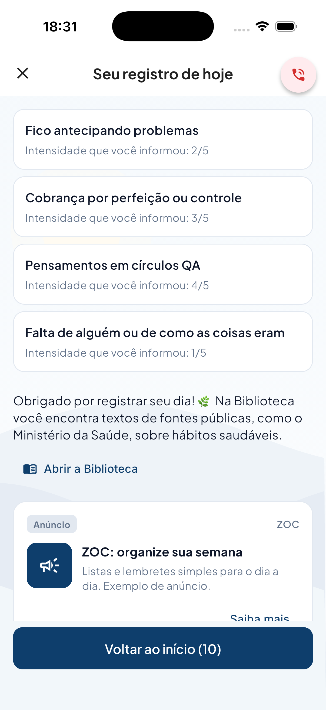
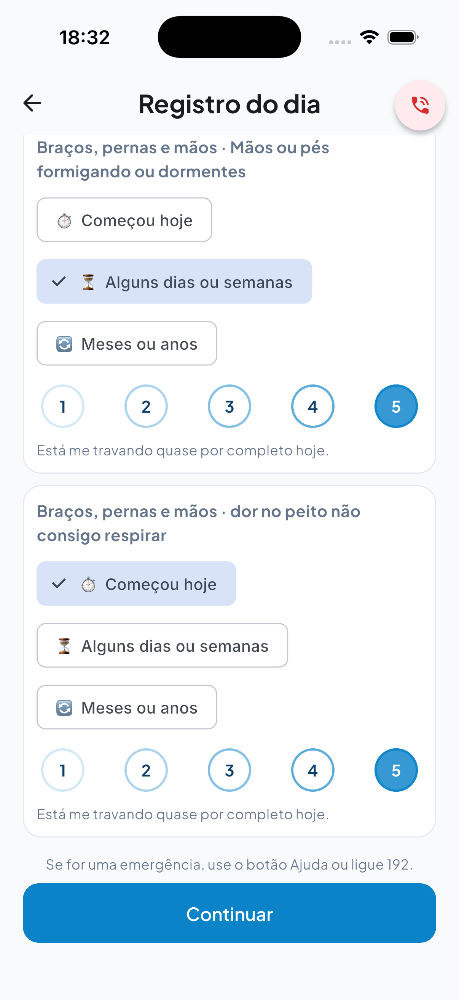
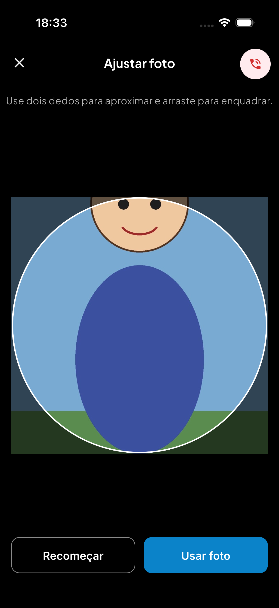
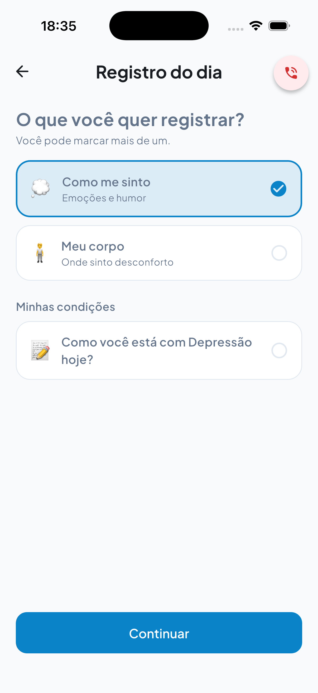
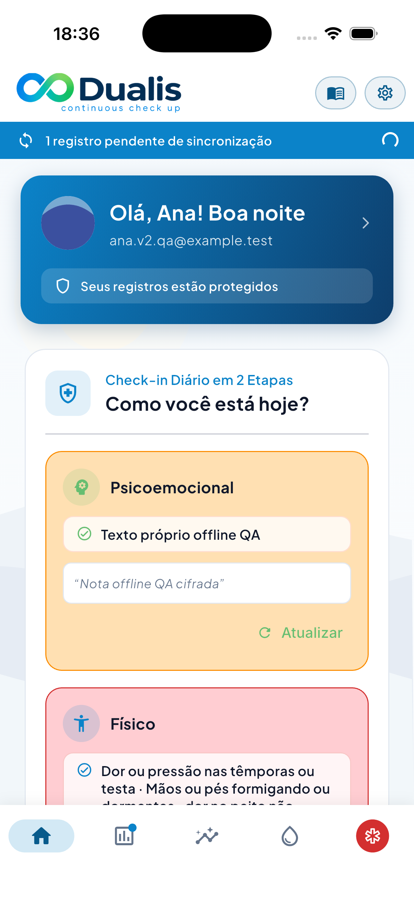
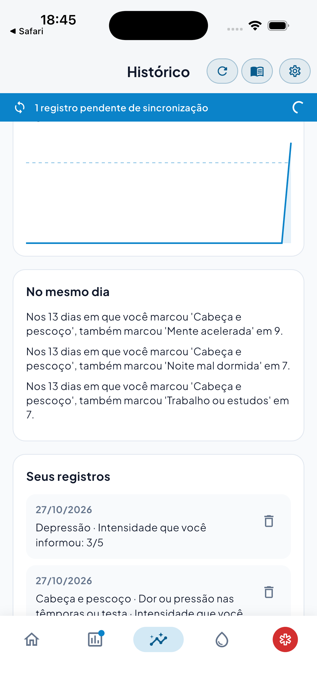
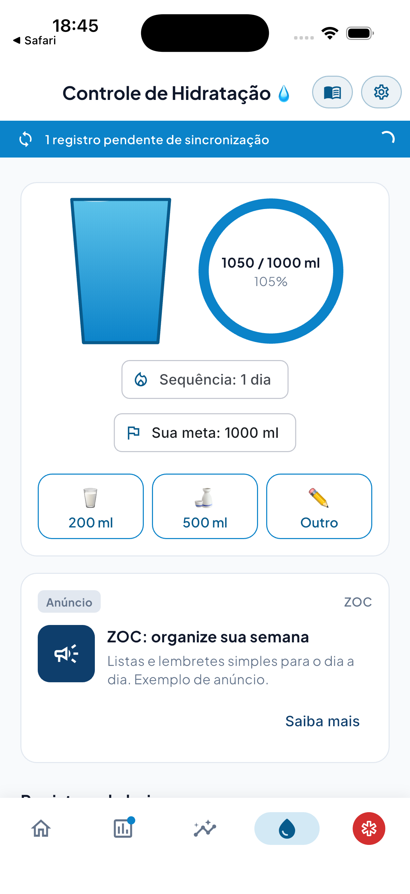

# QA en vivo — Dualis Free v2

Fecha: 27/10/2026. Rama: `feat/dualis-free-v2`. Idioma: pt-BR.

**Veredicto: no aprobar todavía.** Hay un fallo de recorte de foto y recuperación incompleta tras una caída del backend. La oferta de recordatorios no apareció. Además, llegaron cambios concurrentes durante la sesión y las pruebas finales de Flutter fallaron. Las capturas no certifican esos cambios posteriores.

## Entorno y alcance

- iPhone 17, iOS 26.1. Flutter 3.47.6, Dart 3.13.5. Entrada `test_driver/live_main.dart`, API `http://127.0.0.1:3200`, sin `PREMIUM_FEATURES`.
- Docker `dualis-v2-qa-pg`, imagen `pgvector/pgvector:pg17`, puerto 55440. Base funcional `dualis_qa`; bases de pruebas desechables separadas.
- Migraciones hasta `0017_journal_v2.sql`. RLS y FORCE RLS activos en `journal_entries`, `journal_items` y `user_conditions`.
- Backend compilado desde la versión inicial `34e9478`, ejecutado como `dualis_app`, NOSUPERUSER y NOBYPASSRLS. Se comprobó la conexión real en `pg_stat_activity`.
- Configuración QA en directorio temporal. Clave de cifrado aleatoria. SMTP en puerto cerrado. Sin clave Gemini. No se leyó ni imprimió `backend/.env`.
- Ana se registró desde la interfaz. Se verificó su correo directamente en la base. Bruno se creó por API. Solo se usaron datos ficticios.
- Driver de Flutter sobre el servicio VM. Computer Use para el permiso de notificaciones, el selector nativo de fotos y el gesto de zoom. Capturas con `simctl`; todos los PNG pesan menos de 1 MB.

## Resultados

“OK” describe el recorrido observado en la app ejecutada. No implica aprobación de la versión actual del checkout.

| # | Escenario | Resultado | Evidencia y observación |
|---|---|---|---|
| 1 | Alta, consentimiento, Home | PARCIAL | [Consentimiento](01-registro.png), [Home](02-home.png). Alta correcta y «Olá, Ana! Boa noite». No apareció la oferta de agua tras verificar en DB y entrar. |
| 2 | Foto, recorte circular, zoom y arrastre | FALLA | [Antes](13-foto-antes.png), [arrastre](14-foto-ajustada.png), [zoom](14b-foto-zoom.png), [resultado](15-foto-perfil.png). El editor abre y guarda. La parte superior de la cabeza ya está recortada antes de transformar la imagen. |
| 3 | “Bem”, guardado rápido | OK | [Resumen](03-bem-resumo.png). Guarda sin preguntas adicionales. |
| 4 | Emocional con varios ítems y texto propio | OK | [Opciones](04-emocional-opcoes.png), [intensidad](05-emocional-intensidade.png), [desencadenantes](06-gatilhos.png), [resumen](07-emocional-resumo.png). Futuro/Mente acelerada: dos opciones y texto propio. Se agregó Passado. Cuatro intensidades individuales: 2, 3, 4 y 1. |
| 5 | Físico, varias regiones, intensidad 5 | OK | [Espalda](08-mapa-costas.png), [frente](09-mapa-frente.png), [intensidad 5](10-fisico-intensidade5.png), [resumen](12-fisico-resumo.png). Cabeça delante y Membros detrás. El texto «dor no peito não consigo respirar» no dispara avisos. |
| 6 | Condición declarada y archivo | OK | [Alta](16-condicoes.png), [tarjeta diaria](17-condicao-diaria.png), [intensidad registrada](18-condicao-resumo.png), [archivo](19-condicao-arquivada.png). “Depressão” mantiene el nombre original y usa la misma escala. |
| 7 | Sin backend, cola y recuperación | PARCIAL | [Guardado local](20-offline-pendente.png), [pendiente](20b-offline-home.png), [recuperado](35-offline-recuperado.png). Reiniciar solo el backend no sincronizó. Reiniciar la app sí: una sola entrada nueva, sin duplicación. |
| 8 | Dashboard de 30 días | OK | [Distribución y mapa](21-dashboard-resumo.png), [líneas](22-dashboard-linhas.png), [coincidencias](23-dashboard-coincidencias.png). Se sembraron 12 días por API. Se comprobó una corrección temporal del formato de claves; ver incidencias. |
| 9 | Biblioteca y fuente | OK | [Inicio](26-biblioteca.png), [temas](29-biblioteca-temas.png), [últimos temas](29b-biblioteca-oito-temas.png), [OPAS](28-fonte-artigo.png). Se recorrieron los ocho temas y se abrió una fuente real. |
| 10 | Hidratación | OK | [200 ml y anuncio](30-agua-anuncio.png), [500 ml](31-agua-segundo.png), [meta propia](32-agua-meta.png), [sin repetir anuncio](34-agua-sem-repetir-anuncio.png). “Outro”: 350 ml. Total final 1250 ml; meta 1000 ml; racha de un día. Vaso y anillo cambian. |
| 11 | Ayuda en un toque | OK | [Home](25-ajuda-home.png), [journal](11-ajuda-journal.png), [dashboard](24-ajuda-dashboard.png), [biblioteca](27-ajuda-biblioteca.png), [agua](33-ajuda-agua.png), [login](36-ajuda-login.png). Se abrió la pantalla de recursos desde cada origen. No se efectuaron llamadas. |
| 12 | Aislamiento entre usuarios | OK | [API](aislamiento-api.json). Ana ve 16 entradas y una condición activa de control. Bruno ve cero. Usar el perfil de Ana devuelve 403; archivar su condición como Bruno devuelve 404. |
| 13 | Vocabulario y batería | PARCIAL | Los controles de vocabulario y ayuda pasaron. La batería terminó `ACTION_REQUIRED` por Flutter. La prueba completa final también encontró fallos. Ver [pruebas](PRUEBAS.md). |

## Capturas principales

Alta y consentimiento:

Selección múltiple emocional y resumen con las palabras originales:

Intensidad 5 sin aviso dependiente del contenido:

Fallo de recorte: la cabeza queda fuera del encuadre inicial y el arrastre no recupera los píxeles ya recortados:

Condición informada por la persona:

Guardado sin backend:

Conteos del dashboard, sin interpretación:

Hidratación con meta elegida:

## Incidencias corregidas en esta QA

1. `6b52938` — `fix(mobile): preserva o formulário ao escrever item próprio`. “Escrever o meu” provocaba `BoxConstraints forces an infinite width`. El botón dentro de la fila heredaba el ancho infinito del tema. Se acotó su tamaño y las pruebas del flujo usan ahora el tema real. Recorrido emocional y físico repetidos correctamente. Suite focalizada: 10/10.
2. `eba344a` — `fix(mobile): limita largura do botão de adicionar condição`. El mismo problema bloqueaba el alta de condiciones. Se acotó ese botón y se probó con el tema real. Alta, registro diario y archivo comprobados. Condiciones y ajustes: 10/10 en conjunto.
3. `ca958df` — `fix(mobile): abre galeria pelo botão de alterar foto`. “Alterar Foto” abría directamente los avatares. Ahora ofrece cámara, galería y avatares, como el acceso desde la imagen. La prueba comprueba esas opciones y mantiene el acceso a avatares.

Los tres commits incluyen el coautor solicitado. No se hizo push.

## Incidencias abiertas y límites

- **Recorte:** el `BoxFit.cover` se aplica a un cuadrado antes del `InteractiveViewer`. En la imagen de prueba se pierde la parte alta de la cabeza. Cambiar zoom y posición no restaura el contenido descartado. Requiere conservar la imagen original completa durante la transformación.
- **Sincronización:** al volver el backend, la cola siguió pendiente durante la navegación y las consultas nuevas. El worker escucha cambios de conectividad; la conexión del dispositivo no había cambiado. Reiniciar la app completó el envío. Falta un reintento accesible o automático para este caso.
- **Oferta de agua:** no se observó después del alta y del primer login. El correo se verificó en DB porque SMTP estaba desactivado. No se verificó el recorrido OTP real; hay que repetirlo antes de concluir la causa.
- **Coincidencias:** la API del backend ejecutado emitió `futuro.mente` y `trigger.sono`. La app original descartaba esas parejas. Se ajustaron temporalmente los marcadores y se verificaron seis pruebas y la captura. Cambios concurrentes sustituyeron después esa implementación y sus pruebas. Este ajuste temporal no está incluido en los tres commits de QA. Hay que validar nuevamente el contrato del conjunto final.
- **Cambios concurrentes:** después de iniciar la sesión aparecieron decenas de archivos preparados por otro proceso, incluyendo eliminación de IA y migraciones 0018/0019. Se preservaron. No se mezclaron en los commits de QA. El backend y la base funcional de esta sesión corresponden a 0017; las capturas no prueban las migraciones posteriores ni la nueva compilación del backend.
- “Seus itens” como atajos no está implementado. Fotos de fondo con licencia siguen pendientes; se vio el paisaje dibujado incluido en la app.
- No se comprobó IA externa. En la versión ejecutada el etiquetado no está conectado al nuevo flujo. El árbol concurrente elimina ese módulo; esa eliminación no se probó en vivo aquí.
- La escala es de un solo tono, muestra la línea fija de 192 y no muestra calavera. El resumen dice “Intensidade que você informou”, agradece, enlaza a la biblioteca general y etiqueta la publicidad como “Anúncio”. Se seleccionaron desencadenantes en el recorrido emocional y se omitieron en el físico.
- No se probó entrega de notificaciones, cámara real, llamadas telefónicas, producción ni dispositivos Android.

## Base de datos y cifrado

Antes del guardado offline: 4 entradas y 8 ítems. Después de sembrar 12 días: 16 entradas y 32 ítems. Tras reiniciar la app: 17 entradas y 33 ítems.

La API devolvió exactamente “Texto próprio offline QA” y “Nota offline QA cifrada”, una sola vez. En Postgres, `custom_label` y `note` tienen formato cifrado `v1:`. Las condiciones también quedaron archivadas. Se comprobó RLS con usuario de aplicación no privilegiado y por API entre dos usuarios. [Comprobación de recuperación](offline-api.json).

## Pruebas y cierre

El detalle de cantidades, fallos y versiones está en [PRUEBAS.md](PRUEBAS.md). No se modifica `.planning/STATE.md`. Los cambios concurrentes quedan en su estado original de preparación. El informe y las capturas se confirman por separado.

Limpieza completada: app y backend detenidos, pestaña OPAS cerrada, contenedor `dualis-v2-qa-pg` eliminado, iPhone 17 apagado y archivo `.env` QA y tokens temporales borrados. No se detuvieron otros servicios.

Resumen de escenarios: **9 OK, 3 PARCIAL, 1 FALLA**. Pruebas: backend 209 unitarias y 102 e2e aprobadas; RLS final 49 aprobadas; Flutter final 494 aprobadas y 13 fallidas, con errores de finalización.
