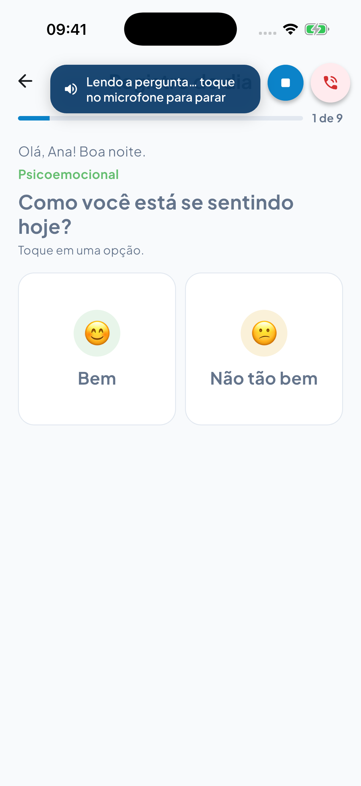
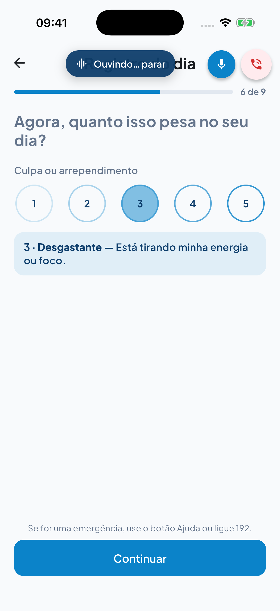
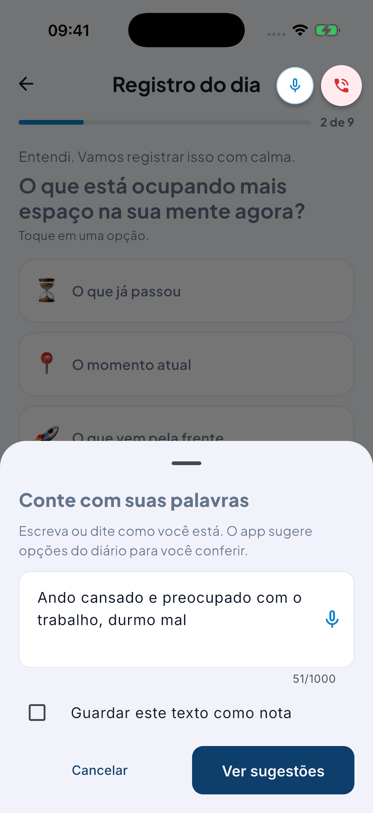
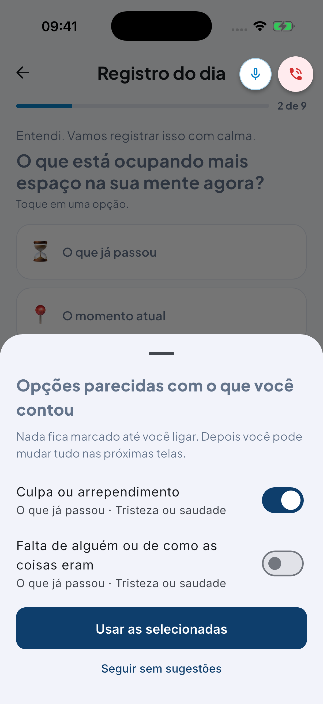
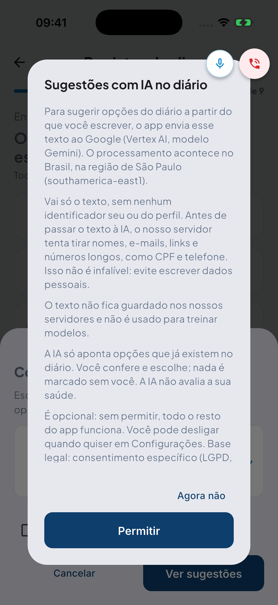
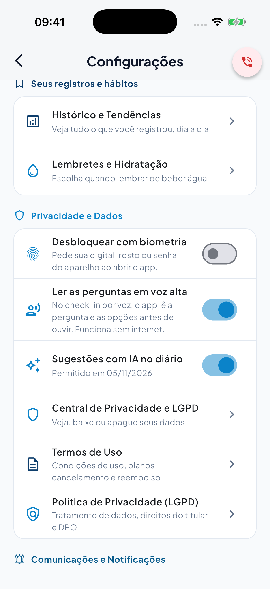
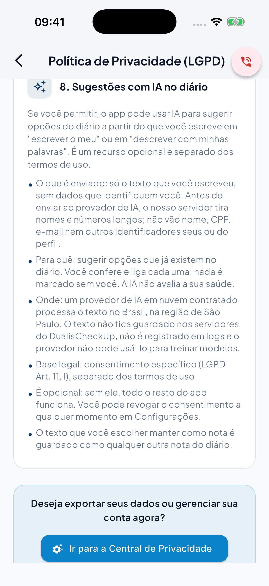
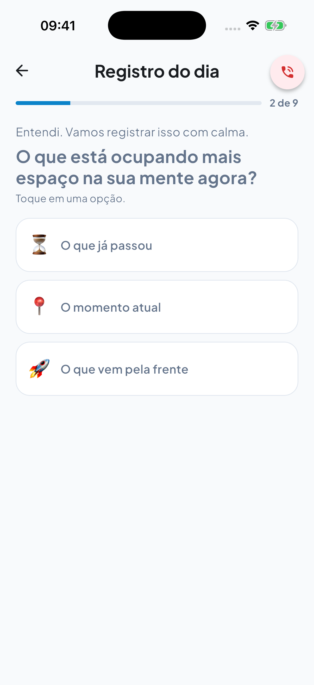
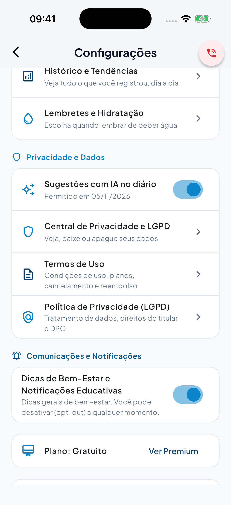

# QA report: Phase 17 (conversational voice check-in, phrases with several answers, describing in your own words, AI consent)

Date: 2026-11-05. Tested by: automated QA agent; report reviewed by the orchestrator.
Device: iPhone 17 Pro simulator, iOS 26.1 (`55A00CEF-138F-41DB-BD39-63BC163A8F22`). Flutter 3.47.6.
Code tested: `main` at `7aa7ffa`. The screenshots were taken at `72d6bf3`, which already includes the fix for the voice banner. Commits after the QA run: `eb28db1` (wording of the privacy policy, see 5.4), which came after screenshot 3.7.

## 1. Summary

The phase delivers four things:

- **Voice dialogue (Premium):** in the hands-free check-in, the app reads the question and up to 6 options aloud before listening. A banner says "Lendo a pergunta… toque no microfone para parar", and tapping the microphone stops it.
- **Phrases with several answers (Premium):** a phrase such as "Culpa ou arrependimento, começou hoje, intensidade três" selects the option, the duration and the intensity, then stops at the intensity step. It never presses "Salvar" or "Pular".
- **Describe in my own words (Premium):** the person writes or dictates how they are. The AI can only return options that already exist in the journal. All of them appear switched off, and the person switches on the ones they want.
- **AI consent (everyone):** a dialog asks for permission before any text is sent to the AI for the first time. Settings has a switch to see the date and revoke it, and the privacy policy has a new section. The server refuses suggestions without consent.

Result: **all automated tests pass** (table in section 4). The simulator run found **one real visual bug**, now fixed: the reading banner covered the microphone it tells you to tap. The database suites also exposed **an intermittent failure in the tests themselves**, now fixed as well. What could not be verified here is in section 7.

## 2. What was tested and how

- **The real app on the simulator.** `integration_test` starts `DualisApp` with its real router, screens, help overlay, `VoiceController` and consent controller. It uses a fake signed-in account (Ana), a keychain, an in-memory local database, and no network calls.
- **Scripted voice input.** `ScriptedVoice` "hears" fixed phrases, so every run goes through the UI the same way.
- **Voice output.**
  - In the screen tests, reading uses a fake in-memory output that can be held for 4 s for the screenshot.
  - Separately, test **P17-TTS** builds the real `FlutterTtsVoiceOutputService` with the `flutter_tts` plugin and reads "Como você está hoje?". The plugin reported `pt-BR` available, chose the `pt-BR` voice, accepted the text and sent the start and end events, in 2.5 s.
  - So the reading ended on the plugin's event, not on the safety timer. The audio itself was not heard: the plugin events were checked, not the sound quality.
- **In-memory API.** Consent, AI suggestions and the journal use in-memory fakes (`FakeAiConsentRepository`, `FakeJournalRemote`). **No calls were made to Vertex/Gemini, the production database or Cloud Run.**
- **Free and Premium.** The same test, built with and without `--dart-define=PREMIUM_FEATURES=true`. The flag is never forced inside the test.
- **Screenshots.** Taken on the Mac by `host_helper.py` (`xcrun simctl io … screenshot`). Each screenshot is the real screen at that moment.
- **Suites in a clean worktree.**
  - A `git worktree` at `HEAD`, without any of your untracked files (billing, 0029, captures).
  - Backend unit, e2e, `tsc`, build, RLS, the content-safety battery, `flutter analyze` and the full `flutter test` ran there.
- **Local database.** A new `pgvector/pgvector:pg17` container on `127.0.0.1:55417`. The RLS tests apply all migrations (0030 included) and query with the runtime role `dualis_app`, as in production.

Test file: [`mobile/integration_test/qa_premium/phase17_qa_test.dart`](../../../mobile/integration_test/qa_premium/phase17_qa_test.dart). To run it again (start the helper first, from `mobile/`):

    python3 integration_test/qa_premium/host_helper.py 55A00CEF-138F-41DB-BD39-63BC163A8F22 \
      com.dualischeckup.app.dualisMobile ../docs/qa-reports/phase-17 &
    flutter test integration_test/qa_premium/phase17_qa_test.dart -d 55A00CEF-138F-41DB-BD39-63BC163A8F22 \
      --dart-define=PREMIUM_FEATURES=true      # Premium: 6 tests
    flutter test integration_test/qa_premium/phase17_qa_test.dart -d 55A00CEF-138F-41DB-BD39-63BC163A8F22
                                               # Free: 2 tests

## 3. Screenshots

### 3.1 Voice dialogue: the app is reading (Premium)

First step of the hands-free check-in. The banner with the speaker reads "Lendo a pergunta… toque no microfone para parar". To its right are the microphone, with the stop icon, and the red help button. What was read: "Como você está se sentindo hoje? Bem, Não tão bem.". Tapping the microphone stopped the reading and hands-free mode. Requirement: **VOICE-02**.

### 3.2 One phrase answers several steps (Premium)

Voice answers: "não tão bem", "O que já passou", "Tristeza ou saudade", then a single phrase: "Culpa ou arrependimento, começou hoje, intensidade três".

- The app selected the option and the duration "hoje", and stopped at the intensity step with 3 selected (state checked: `passado.tristeza.culpa`, `hoje`, intensity 3).
- Nothing was saved: "Continuar" is left to the person.
- Then "parar" ended hands-free mode.

Requirement: **VOICE-03**. Observation: the "Ouvindo… parar" banner sits over the title "Registro do dia" (text over text). It is legible, but should be moved; see section 8.

### 3.3 Describe in my own words (Premium)

On the step "O que está ocupando mais espaço na sua mente agora?", the row "Descrever com minhas palavras" opens the sheet. The test text is made up: "Ando cansado e preocupado com o trabalho, durmo mal". The sheet shows the 51/1000 counter, the dictation microphone and "Guardar este texto como nota", off by default. The help button stays visible and can be tapped above the sheet. Requirement: **JOURNAL-AI-01**.

### 3.4 Reviewing suggestions (Premium)

The fake server returned two existing options.

- **Both appeared switched off** (checked before any tap). In the screenshot the test has already switched on the first one.
- The text explains "Nada fica marcado até você ligar".
- "Usar as selecionadas" applied only the option that was on (`passado.tristeza.culpa`), and the flow moved on to the duration step without saving anything.
- The app sent the text and the area (`emotional`) and nothing else.

Requirement: **JOURNAL-AI-01**.

### 3.5 Consent dialog (Premium; the dialog is the same for everyone)

With no earlier consent, tapping "Ver sugestões" first opened this dialog. **Nothing was sent before "Permitir"** (checked: zero suggestion requests). After "Permitir", consent was recorded for version `2026.1`, and only then did the request go out. The text says the server tries to remove names, e-mails, links and long numbers, and that "Isso não é infalível". Requirement: **LGPD-AI-01**.

### 3.6 Settings: consent and reading aloud (Premium)

Under "Privacidade e Dados" there are "Ler as perguntas em voz alta" (on) and "Sugestões com IA no diário" with "Permitido em 05/11/2026". The date comes from the fake server. Requirements: **LGPD-AI-01**, **VOICE-02**.

### 3.7 Privacy policy, section 8 (Premium; the section is the same for everyone)

"8. Sugestões com IA no diário" covers:

- what is sent and why;
- where it goes: a contracted cloud provider in the São Paulo region; it is not stored, not logged and not used for training;
- the legal basis (LGPD art. 11, I);
- that it is optional and revocable;
- that a saved note is treated like any other note.

Note: this screenshot was taken before `eb28db1`. The first bullet now says the server *tries* to remove names and long numbers, that this is not foolproof, and that personal details are best left out, the same as the consent dialog. Requirement: **LGPD-AI-01**.

### 3.8 Free: no "Descrever com minhas palavras"

Free build, same step: only the three time options. There is no describe row and no microphone, and the help button is visible.

### 3.9 Free: Settings

In Free, the AI consent switch appears, because "Escrever o meu" can also use the AI. "Ler as perguntas em voz alta" and biometrics do not appear. Note: it shows "Permitido em 05/11/2026" only because the test fake starts with consent given. It does not mean a Free user gave it.

## 4. Results

Clean worktree at `7aa7ffa`, new database. The e2e tests use throwaway local variables (random `ENCRYPTION_MASTER_KEY`, local `DATABASE_URL`, `VERTEX_PROJECT=mock-e2e`), never `backend/.env`, which holds production values.

| Test | Command | Result |
|---|---|---|
| Backend unit | `npm test` | 32 files, **521/521** |
| Backend e2e (no DB) | `npm run test:e2e` | **113 passed**, 16 skipped (they need a DB) |
| Backend e2e (local DB) | `TEST_DATABASE_URL=… npm run test:e2e` | 15 files, **129/129** |
| Types | `npx tsc --noEmit -p tsconfig.json` | no errors |
| Build | `npm run build` | ok |
| RLS (new DB, role `dualis_app`) | `TEST_DATABASE_URL=… npm run test:rls` | 12 files, **118/118**; `ai-consents-rls.spec.ts` 7/7 (not skipped) |
| Content-safety battery | `npm run test:battery` | **PASSED**: vetted vocabulary **0**, help in **≤1 tap** OK, backend and Flutter clean |
| Flutter analysis | `flutter analyze --no-fatal-infos` | no issues |
| Full Flutter suite | `flutter test` | **935/935** |
| Simulator QA, Premium | `phase17_qa_test.dart` + `PREMIUM_FEATURES=true` | **6/6** |
| Simulator QA, Free | `phase17_qa_test.dart` | **2/2** |

After the fix in 5.2, RLS and e2e with a DB were each run **10 times in a row**: 10/10 clean in both.

Run after the report by the orchestrator, for `77004c1` and `eb28db1`: `legal.service.spec.ts` 35/35. Flutter privacy, consent, settings and vocabulary tests: green. The new texts have 0 hits in the vetted vocabulary.

## 5. Bugs found and fixed

### 5.1 The reading banner covered the microphone: FIXED

The banner "Lendo a pergunta… toque no microfone para parar" sat on top of the microphone it tells you to tap. Fix (`72d6bf3`): in the check-in, the banner ends to the left of the microphone. A new test checks this at 402 pt and 320 pt: neither the microphone nor the help button is covered. It failed before the fix and passes after.

### 5.2 Intermittent failure when dropping the test databases: FIXED

This was not an app bug. Sometimes vitest ended with exit code 1 even though every test passed: the `DROP DATABASE … WITH (FORCE)` killed a connection that was still closing. Fix (`2a988b1`, `7aa7ffa`): a single helper, `backend/test/support/drop-test-database.ts`, waits until no connections are left. Your untracked `billing-rls.spec.ts` was not touched.

### 5.3 The consent dialog promised too much: FIXED (`77004c1`)

It said "the app" removes names and "other numbers" before sending. In reality the server does it, it only removes long numbers (CPF, phone), and name removal is a heuristic. The dialog now says exactly that, says it is not foolproof, and asks the person not to write personal details.

### 5.4 The privacy policy stated it as absolute: FIXED (`eb28db1`)

The AI section said "não vão nome, CPF, e-mail". It now says the server tries to remove them and that this is not foolproof, in the API policy and in the app, in pt, es and en.

### 5.5 Fixed in the earlier plans of the phase

- A late cancellation of the previous speech could cut off the new reading and open the microphone while the app was still speaking.
- Tapping the microphone in the pause between two answers started a second listen.
- Signing out turned reading aloud back on.
- In a multi-answer phrase:
  - "Continuar" was still disabled right after answering;
  - naming the same option twice unselected it;
  - "<option>, pular" could skip the step.
- Riverpod's automatic retry delayed the offline answer for the consent.

## 6. Decisions respected

- **The AI only returns keys of options that already exist** in the area on screen (at most 4). The server filters and the app filters again. Nothing about mood, duration or intensity is set by the AI.
- **The person switches on each suggestion.** They all start off, and nothing is saved without "Salvar".
- **No diagnosis, condition, severity, urgency or intensity decided by the AI.** Vetted vocabulary: 0.
- **The app does not react to the content of the text** (strategy §18.2): there is no self-harm flag, and help is always the same.
- **Help in ≤1 tap everywhere**, including while the app reads, with the describe sheet open and with the consent dialog open.
- **Nothing is sent without consent.** The server responds 403 `AI_CONSENT_REQUIRED`, and profiles shared by another account get 403 `AI_PROFILE_NOT_ALLOWED`.

## 7. What was NOT verified

- **Audio on a real iPhone and on the Xiaomi (Android 16):** that the reading plays on the speaker, that it works offline on Android, and that the app **does not hear itself**.
- **How real recognizers return a phrase with several answers** (with commas or without). The logic accepts both forms in tests, but it has not been tried with a real voice.
- **The real quality of Gemini/Vertex suggestions.** No real calls were made.
- **Banner and help button on a real narrow phone.** This was only checked in a widget test at 320 pt.
- **Production migration and deploy.** Production was not touched.

## 8. Observations (not fixed in this phase)

- **The check-in microphone is drawn on top of the sheets and the consent dialog** (screenshots 3.3 to 3.5), and it can be tapped while they are open. It would be better to hide it while a sheet or dialog is open.
- **The "Ouvindo… parar" banner covers the title "Registro do dia"** (screenshot 3.2). It is legible, but text over text looks poor. Move it below the bar or hide the title while listening.
- "Não é usado para treinar modelos" depends on the Google Cloud data processing terms, which are still **unconfirmed** (section 9).

## 9. To do for the owner (manual)

1. **Migration 0030 in production, by hand,** with the role that owns the tables: `backend/src/database/migrations/0030_ai_processing_consents.sql`. Do not use `drizzle-kit generate`.
2. **Deploy order:** the app with the consent dialog must ship **before or together with** the backend. Otherwise "Escrever o meu" responds 403 to everyone until each person gives consent.
3. **`PRIVACY_VERSION`:** if production pins it in `BACKEND_ENV`, raise it to **`2026.5`**. `DISCLAIMER_VERSION` stays at `2026.1`.
4. **Gap in migration numbering:** 0030 has idx 30 in `_journal.json`. Your untracked `0029_revenuecat_subscriptions.sql` will need **idx 31** or a rename to 0031.
5. **Google Cloud data processing terms ("no training")** and the international transfer clause (LGPD art. 33): still to be confirmed.
6. **Audio test** on the iPhone and the Xiaomi: a check-in by voice, plus one phrase with several answers.
7. **Live evaluation** of 5 to 10 descriptions with Vertex, spaced at least 6.5 s apart.
8. **Premium is only enforced in the app.** The server limits (3/min and 20/day per person, 8/min shared) are kept **in each instance's memory**.
9. The consent for reading documents is still stored **only on the device** (outside this phase).

## Files from this QA

- Test: `mobile/integration_test/qa_premium/phase17_qa_test.dart`
- Banner test: `mobile/test/shared/widgets/urgent_help_button_test.dart`
- Test helper: `backend/test/support/drop-test-database.ts`
- Screenshots: this folder (9 PNG)
