# QA report: Premium biometric unlock and voice

Date: 2026-11-02. Tester: QA agent (automated, iOS Simulator).
Device: iPhone 17 Pro simulator, iOS 26.1 (`55A00CEF-138F-41DB-BD39-63BC163A8F22`).
Flutter 3.47.6. Code under test: the working tree at 17:46.

- It includes the parent thread's lock and voice changes: "Sair da conta" on the lock screen, the cold-start cover, "no lock without a stored session", 3 misses before hands-free stops, and the mic closing on the help screen.
- It also includes the fixes for bugs 1 and 2 from the first run. All screenshots and videos in this folder are from the second run. The first run's bug evidence is kept in [before_fix/](before_fix/).

## Summary

- Automated scenarios: **22 PASS, 0 FAIL** (Premium 18, Free 4) on the code with the fixes. Run log: [test_runs.txt](test_runs.txt).
  - In the full Premium voice run, P-V1 failed once because of a mistake in my own check. The counter text was the top item under the tap point, which proves it is not covered, but the check expected another type. I fixed the check and re-ran P-V1 alone: PASS.
- Real-microphone check (optional): **not verified**. The app crashed on the simulator when the real speech engine opened the audio input (see bug 3).
- Free build: no mic, no dictation icons, no biometric switch and no lock anywhere we looked.
- Bugs: **bug 1 (mic covering content) FIXED**, **bug 2 (password field losing focus) FIXED**, both re-verified on the simulator. **Bug 3** (real speech engine crashed the app on the simulator) is still open; it needs a real-iPhone check. There are also 3 observations.
- Where the mic lives now (Premium only): in the Home app bar, and on the **check-in screen only**, left of the red help button inside the app bar band. No other screen has a mic. Free: no mic anywhere.

## How it was tested

- The tests boot the **real app** (`DualisApp`: the real router, screens, overlays, `AuthController`, `BiometricLockController` and `VoiceController`). They use a fake signed-in account (`ana@example.test`), an in-memory keychain and journal store, and no network.
- The Premium build is the real compile flag: `--dart-define=PREMIUM_FEATURES=true`. The flag is never overridden in the tests.
- Biometrics use the **real `local_auth`** plugin. The system Face ID sheet appears on the simulator. The Mac sends Face ID match or no-match with `notifyutil`.
- Voice uses a **scripted speech engine** (`ScriptedVoice`). It "hears" fixed phrases, with partial text first and then the final text, so the real UI is driven the same way on every run.
- A small helper on the Mac ([host_helper.py](../../../mobile/integration_test/qa_premium/host_helper.py)) takes screenshots and videos, sends Face ID match or no-match, and sends the app to the background (by opening the Settings app) and back. Its log is in [host_helper_log.txt](host_helper_log.txt).
- Test files: `mobile/integration_test/qa_premium/biometric_qa_test.dart`, `voice_qa_test.dart`, `qa_harness.dart` and `real_mic_main.dart`.

Rerun (start the helper first, then one suite at a time):

```bash
cd mobile
python3 -I integration_test/qa_premium/host_helper.py <udid> com.dualischeckup.app.dualisMobile ../docs/qa-reports/premium-voice-biometric &
flutter test integration_test/qa_premium/biometric_qa_test.dart -d <udid> --dart-define=PREMIUM_FEATURES=true   # Premium
flutter test integration_test/qa_premium/biometric_qa_test.dart -d <udid>                                      # Free
flutter test integration_test/qa_premium/voice_qa_test.dart -d <udid> --dart-define=PREMIUM_FEATURES=true
flutter test integration_test/qa_premium/voice_qa_test.dart -d <udid>
```

## Scenario table

### A. Biometric unlock

| ID | Build | Steps | Expected | Actual | Result | Evidence |
|---|---|---|---|---|---|---|
| P-B1 | Premium | Open Settings | "Desbloquear com biometria" switch shown, off | Shown, off | PASS | premium_B01_settings_switch_off.png |
| P-B2 | Premium | Tap the switch, Face ID **no-match**, then match | Stays off while "Rosto não reconhecido" shows; turns on after the match | As expected; snackbar "Desbloqueio com biometria ativado." | PASS | premium_B02_faceid_sheet_enable.png, premium_B02_faceid_nomatch_sheet.png, premium_B02_enabled_after_match.png |
| P-B3 | Premium | Lock on. Real background for 10 s, then real background for 65 s. Face ID no-match, then match | 10 s: no lock. 65 s: lock and automatic Face ID prompt. No-match: still locked. Match: unlocked on the same screen | As expected. One automatic prompt only. The app-switcher cover is gone after coming back | PASS | premium_B03_after_10s_background_open.png, premium_B03_locked_auto_prompt.png, premium_B03_locked_nomatch.png, premium_B03_unlocked_back_on_settings.png, video premium_B03_lock_after_65s.mp4 |
| P-B4 | Premium | Lock (clock jumps 61 s, real 4 s background). Prompt cancelled. Check the buttons; tap help; close help; tap "Desbloquear" (fails); "Entrar com senha": empty, wrong, then the right password typed **without tapping the field again**; lock again; "Desbloquear" with a Face ID match | Only Desbloquear, Entrar com senha, Sair da conta and the red help button. Help opens while locked. The lock comes back after help with no new prompt. Wrong password keeps it locked, **the field keeps focus with the text selected**. Right password unlocks. Desbloquear + match unlocks | As expected. System back does not pop screens under the lock. Wrong password: "E-mail ou senha incorretos…"; focus kept; selection 0–12 of 12 characters; keyboard still up | PASS | premium_B04_lock_screen.png, premium_B04_help_while_locked.png, premium_B04_lock_back_after_help.png, premium_B04_password_form.png, premium_B04_password_wrong.png, premium_B04_unlocked_with_password.png, premium_B04_unlock_button_faceid.png, premium_B04_unlocked_with_button.png, video premium_B04_lock_help_password.mp4 |
| P-B5 | Premium | Locked, tap "Sair da Conta", confirm | Session ends, lock off, flag cleared | Goes to `/onboarding`; lock off; flag false | PASS | premium_B05_sign_out_confirm.png, premium_B05_signed_out.png |
| P-B6 | Premium | Lock on, close the app (keychain kept), start again | Covered from the first frame; Face ID prompt; match opens Home | As expected | PASS | premium_B06_cold_start_faceid.png, premium_B06_cold_start_unlocked_home.png, video premium_B06_cold_start_lock.mp4 |
| P-B7 | Premium | Saved "on" flag but no session, start the app | No lock; start screen | No lock; `/onboarding` | PASS | premium_B07_flag_without_session.png |
| P-B8 | Premium | Turn the switch off, background, cold start | No lock | No lock; Home | PASS | premium_B08_disabled.png |
| P-B9 | Premium | Face ID **not enrolled**, open Settings, tap the switch | Switch shown (device passcode counts); stays off until confirmed | Switch shown. iOS asks for the device passcode ("Digite o código do iPhone para Dualis / Confirme para ativar…"). Stays off | PASS | premium_B09_not_enrolled_passcode_sheet.png |
| F-B1 | Free | Open Settings, scroll to the end | No biometric switch | None | PASS | free_B_settings_top.png, free_B_settings_bottom.png |
| F-B2 | Free | Real background for 65 s | No lock | No lock; Home | PASS | free_B_after_65s_background.png |
| F-B3 | Free | Saved "on" flag plus session, cold start | No lock | No lock; Home | PASS | free_B_cold_start_with_flag.png |

### B. Voice

| ID | Build | Steps | Expected | Actual | Result | Evidence |
|---|---|---|---|---|---|---|
| P-V1 | Premium | Home; Settings; History, Hydration, Habits; check-in | Mic in the Home app bar. No mic in Settings, History, Hydration or Habits. On the check-in, the mic sits left of the help button and covers nothing | As expected. Settings: the biometric switch does not overlap the help button, and a tap at its right edge reaches the switch. Check-in: mic at x 298–338, help at x 346–390, "2 de 7" counter at y 122–141, below both; the counter is the top item under a tap | PASS | premium_V01_home_mic_in_app_bar.png, premium_V01_settings_no_mic_switch_visible.png, premium_V01_hydration_no_mic.png, premium_V01_check_in_mic_and_counter.png |
| P-V2 | Premium | From the Home mic: "histórico", "água", "registrar água", "hábitos", "configurações", "eu preciso de ajuda" (back to Home between commands with the back arrow) | Each opens its screen; water +250 ml; no mic on the opened screens; help opens; the mic closes on help; commands are ignored on help | All as expected. Water went from 0 to 250 ml ("Registrado: um copo de água (250 ml)"). No mic on History or on help. "histórico" said on help did nothing | PASS | premium_V02_*.png (each with a `_listening` frame), video premium_V02_voice_commands.mp4 |
| P-V3 | Premium | Say "abacaxi voador" on Home | Nothing changes; "not understood" message | As expected | PASS | premium_V03_not_understood.png |
| P-V4 | Premium | "como me sinto", then **one tap** on the check-in mic (left of the help button), then say: não tão bem, branch, option, continuar, começou hoje, três, continuar, pular, pular, note text, salvar | Whole check-in by voice; saved; listening stops after leaving the flow | Saved 1 entry (option, persistence `hoje`, intensity 3, note "hoje foi um dia longo"). 11 listens for 11 answers. Not listening on the summary | PASS | premium_V04_step_01/03/05/06/10.png, premium_V04_saved_summary.png, video premium_V04_hands_free_check_in.mp4 |
| P-V5 | Premium | Hands-free: "não tão bem", "parar" | Stops after "parar" | 2 listens, then stopped. First answer applied | PASS | premium_V05_stopped_on_parar.png |
| P-V6 | Premium | Hands-free: "não tão bem", silence, "abacaxi voador", silence | Stops by itself after 3 misses in a row | Stopped after exactly 3 misses (4 listens) | PASS | premium_V06_stopped_after_misses.png |
| P-V7 | Premium | Hands-free: "não tão bem", "socorro" | Help opens, listening stops | As expected | PASS | premium_V07_help_from_check_in.png |
| P-V8 | Premium | In the check-in say "voltar" on the options step | One step back, still in the check-in | Back on the branch step | PASS | premium_V08_voltar_in_check_in.png |
| P-V9 | Premium | Dictation mic in "Escrever o meu", in the trigger note ("Outro") and in the note | Spoken text written in each field | "cansaço de tela", "discussão no trabalho", "dormi pouco" written. Bonus: with 2 items on the intensity step, voice answered both cards | PASS | premium_V09_custom_field_mic.png, premium_V09_custom_dictated.png, premium_V09_two_items_by_voice.png, premium_V09_trigger_note_dictated.png, premium_V09_note_dictated.png, video premium_V09_dictation.mp4 |
| F-V1 | Free | Home, Settings, check-in ("Escrever o meu", trigger note, note); ask voice to start | No mic anywhere; no dictation icon or empty icon space; nothing listens | As expected. `suffixIcon` is null; 0 listens | PASS | free_V_home_no_mic.png, free_V_settings_no_mic.png, free_V_write_mine_no_dictation.png, free_V_trigger_note_no_dictation.png, free_V_note_no_dictation.png |
| R-1 | Premium | Real speech engine (`real_mic_main.dart`). Listening starts by itself; the Mac plays `say -v Luciana "histórico"` on its speakers | Recognises "histórico" | "Ouvindo…" shows, then the **app crashes** about 10 s later (2 of 2 tries) | NOT VERIFIED | premium_R01_real_mic_app_crashed.png, real_mic_crash_simulator.txt |

## Key screenshots

Biometric unlock (Premium):

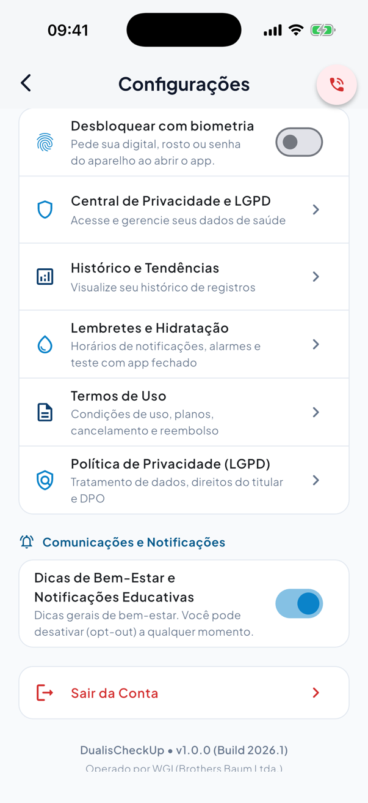
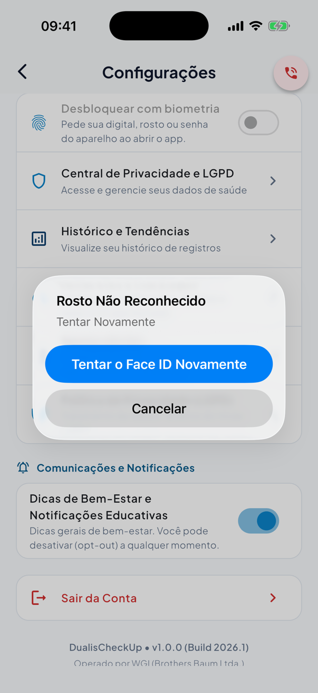
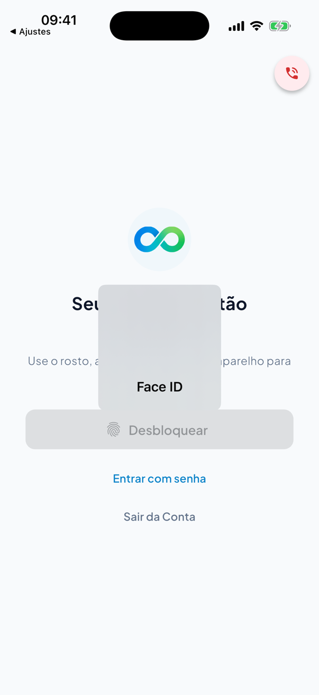
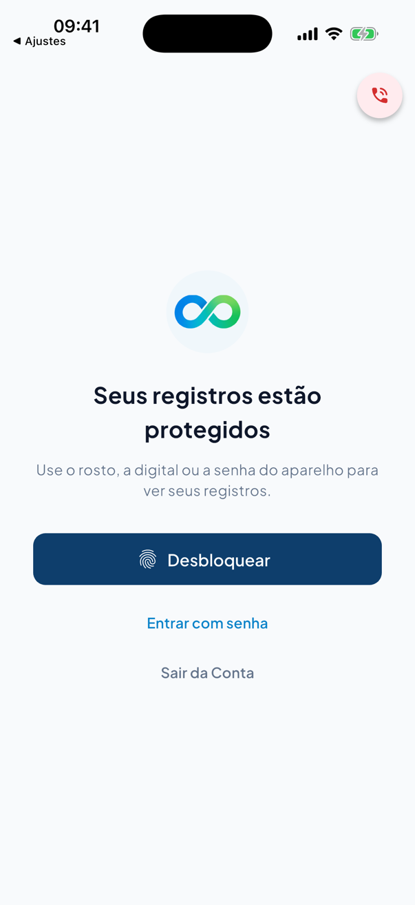
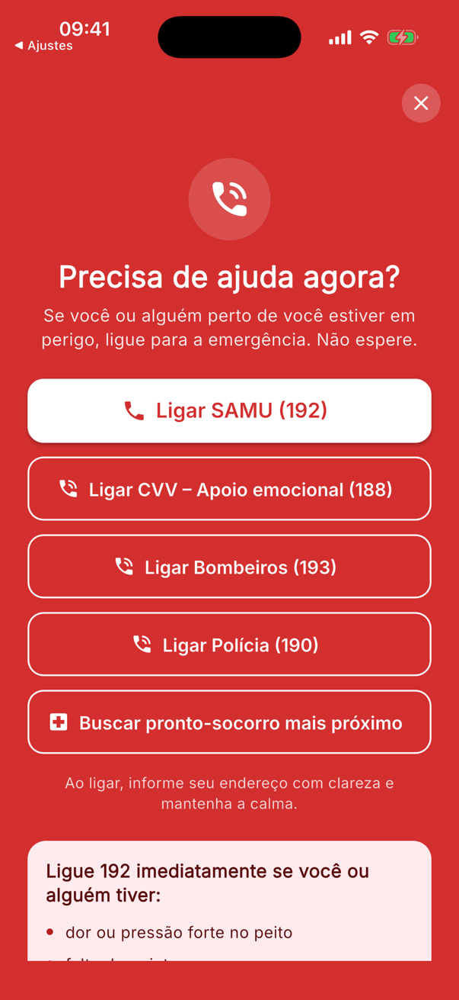
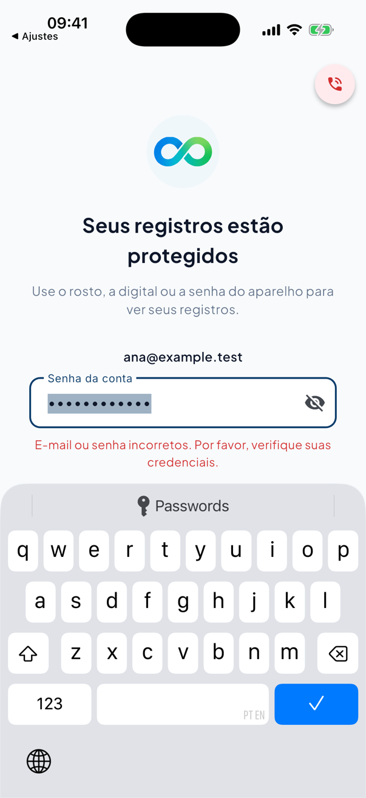


Voice (Premium):

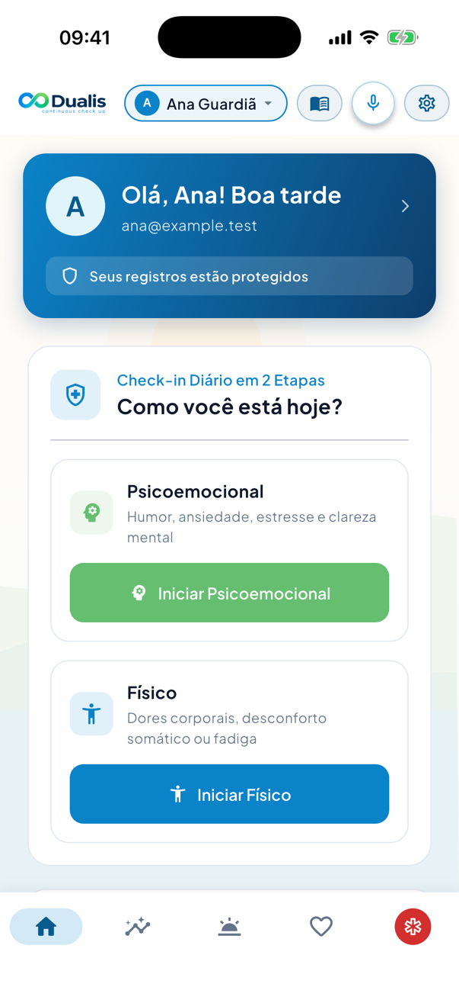
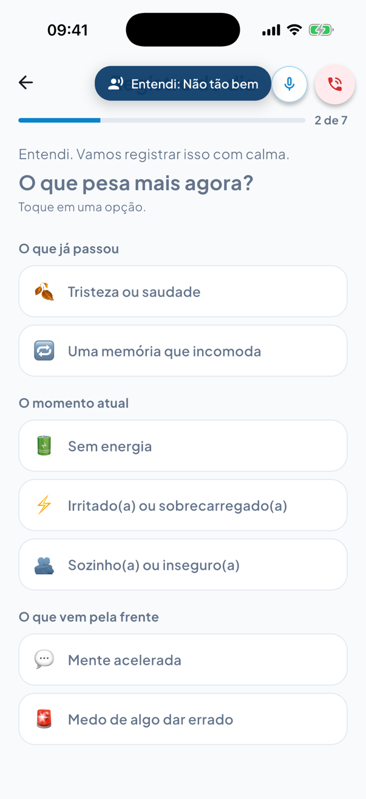
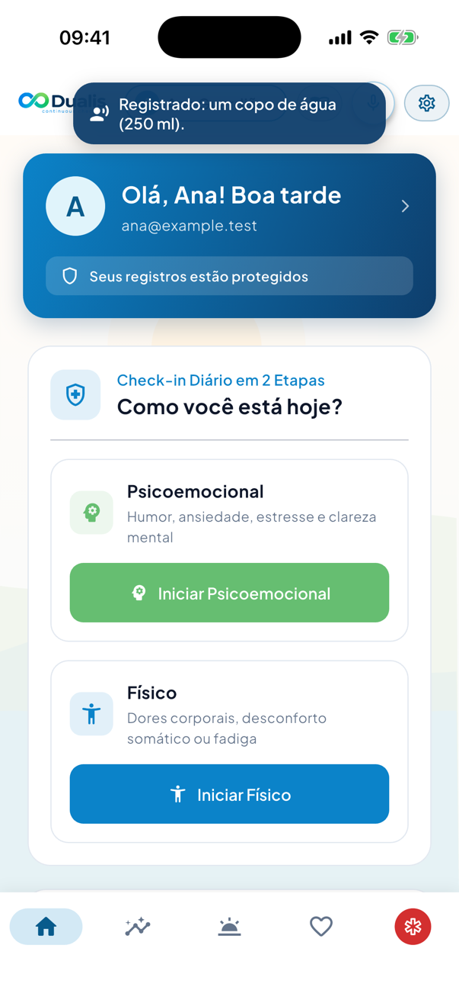
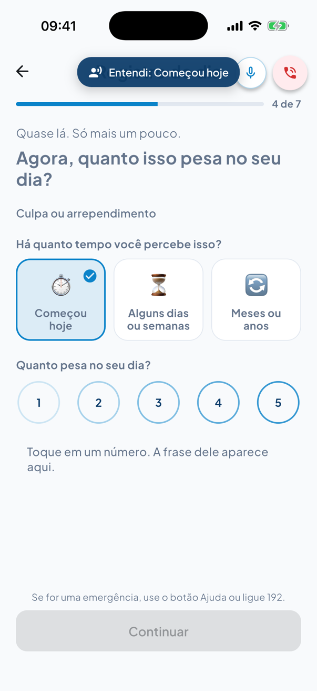
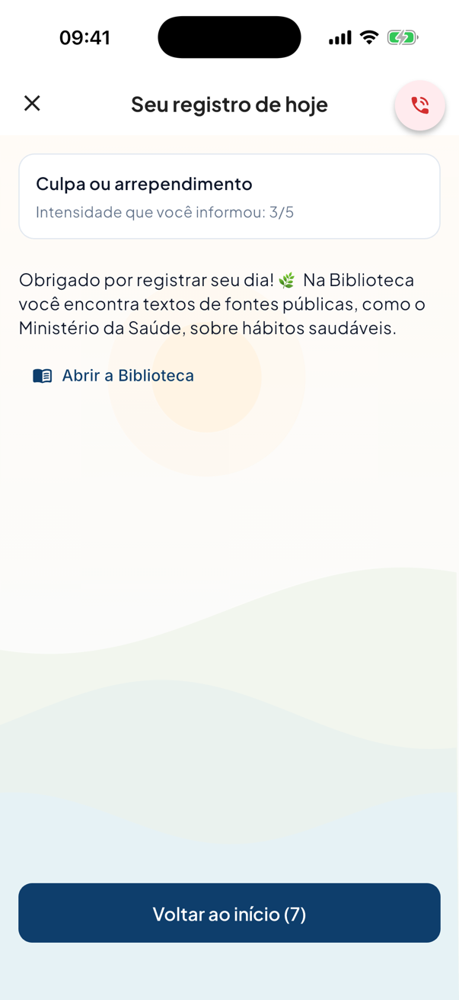
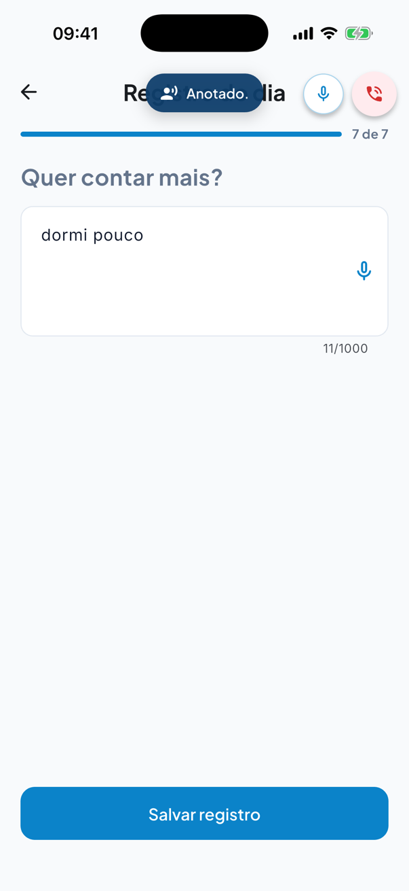

Free build:

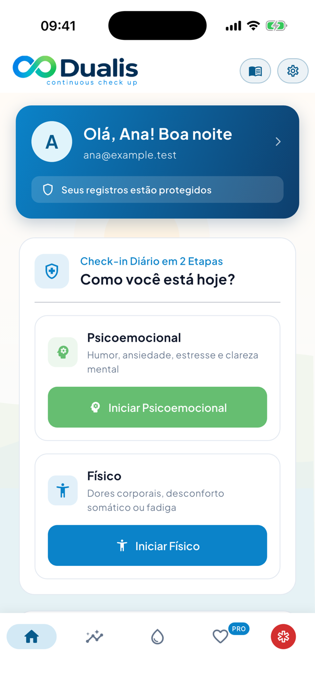
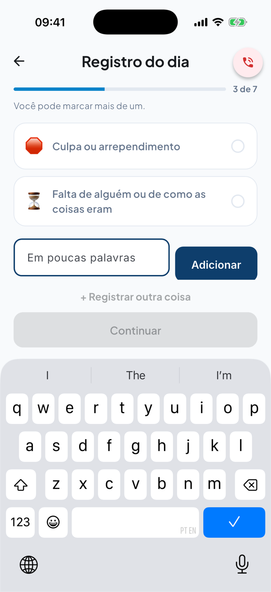
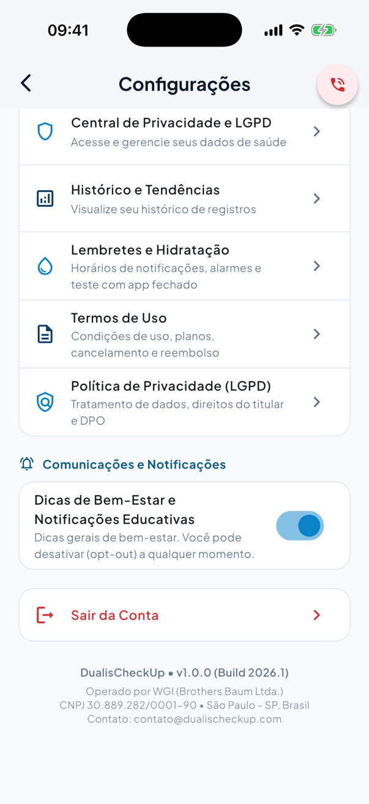

Videos (each 60 s or less):
[B03 lock after 65 s](premium_B03_lock_after_65s.mp4) (16 s),
[B04 lock screen, help, password, unlock](premium_B04_lock_help_password.mp4) (47 s, includes the bug 2 fix),
[B06 cold start](premium_B06_cold_start_lock.mp4) (8 s),
[V02 voice commands](premium_V02_voice_commands.mp4) (27 s),
[V04 hands-free check-in](premium_V04_hands_free_check_in.mp4) (25 s),
[V09 dictation](premium_V09_dictation.mp4) (31 s).

## Bugs

### 1. The mic below the red help button covered screen content (Premium) — FIXED

Before: the 40 px mic sat under the help button on every screen. It covered the right end of the biometric switch in Settings, the check-in step counter ("3 de 7"), and card corners. See [before_fix/bug1_settings_switch_covered.png](before_fix/bug1_settings_switch_covered.png), [before_fix/bug1_check_in_counter_hidden.png](before_fix/bug1_check_in_counter_hidden.png) and [before_fix/bug1_hydration_card_covered.png](before_fix/bug1_hydration_card_covered.png).

After the fix (re-verified, Premium and Free):

- Settings has no mic. The biometric switch is fully visible, and a tap at its right edge reaches the switch (premium_V01_settings_no_mic_switch_visible.png).
- History, Hydration and Habits have no mic (premium_V01_hydration_no_mic.png, premium_V02_historico.png).
- On the check-in, the mic sits left of the help button in the app bar band. The "N de 7" counter is visible below both buttons (premium_V01_check_in_mic_and_counter.png, premium_V04_step_05.png).
- Hands-free check-in from that mic still works end to end (P-V4, P-V5, P-V6, P-V7, P-V9).
- Free still shows no mic (free_V_*.png).

### 2. After a wrong password on the lock screen, the field lost focus — FIXED

Before: after a wrong password the keyboard closed and the field lost focus. The person had to tap the field again ([before_fix/bug2_wrong_password_no_keyboard.png](before_fix/bug2_wrong_password_no_keyboard.png)).

After the fix: the field keeps focus, the wrong text is selected (0–12 of 12 characters) and the keyboard stays up. The right password typed straight away, with no tap on the field, unlocks the app (P-B4; premium_B04_password_wrong.png, premium_B04_unlocked_with_password.png).

### 3. The real speech engine crashed the app on the iOS Simulator — check on a real iPhone

When the real `speech_to_text` engine started listening, the app aborted (SIGABRT) about 10 s later. It happened on 2 of 2 tries. The crash is inside Apple CoreAudio: `AURemoteIO::Initialize` hit "RPC timeout. Apparently deadlocked. Aborting now." It was called from `SpeechToTextPlugin.initAudioEngine` and then `AVAudioEngine.inputNode`. Excerpt: [real_mic_crash_simulator.txt](real_mic_crash_simulator.txt).

This is very likely a simulator audio problem. This Mac uses an external mic as input and headphones as output. But it is not proven. Run one real-device check of the mic and dictation before release. The app has no guard if the audio engine stalls.

Repro:
1. Grant Microphone and Speech Recognition to the app on the simulator.
2. Run `flutter run -d <udid> --dart-define=PREMIUM_FEATURES=true -t integration_test/qa_premium/real_mic_main.dart`.
3. Wait for "Ouvindo…". About 10 s later the app closes.

## Observations (not bugs)

- With the mic now only on Home and on the check-in, app-wide voice commands ("histórico", "água", "configurações" and the rest) can only be started from Home. "voltar" by voice now works only inside the check-in. This is a product choice; it is noted here so it is a conscious one.
- On the check-in, the voice banner now ends right next to the mic and covers the "Registro do dia" title while it shows (premium_V01_check_in_mic_and_counter.png). It does not cover the mic or the counter.

- The voice banner ("Entendi: histórico", "Anotado.") covers the screen title for about 2.6 s (premium_V02_historico_listening.png, premium_V04_step_10.png). This is acceptable if intended.
- With Face ID not enrolled, the switch still shows. Turning it on asks for the device passcode, because `biometricOnly: false`. This matches "Face ID / Touch ID / device passcode".
- The "◀ Ajustes" text in the status bar of some screenshots is iOS's back-link. The helper opened the Settings app to send Dualis to the background.

## What could not be verified on the simulator, and why

- **Tapping "Cancelar" on the system Face ID or passcode sheet.** Automation cannot reach the Simulator window (no accessibility access), and a Face ID no-match leaves the sheet open until someone taps. Where a cancelled prompt was needed (P-B4 and P-B5), a thin wrapper around the real service returned `false` instead of opening the sheet. Every other prompt (9 that finished, plus the P-B9 passcode sheet) was real `local_auth`. See the prompt lines in host_helper_log.txt.
- **Entering the device passcode** (P-B9) is blocked for the same reason. It was checked only up to the system sheet.
- **The 60 s rule** was run once in real time (65 s, P-B3; plus 65 s on Free). The other lock scenarios used the controller's test clock, which jumps 61 s, with real 4 s background trips.
- **Cold start** means the whole app (widgets and all state) is dropped and rebuilt in the same process. The keychain is the plugin's in-memory mock, not the iOS keychain. A full process kill cannot be done inside `flutter test`.
- **App-switcher snapshot cover.** The test only checked that it is gone after the app returns. Its look in the app switcher was not captured.
- **Real speech recognition** (bug 3). The `say` voice was played on the Mac speakers, but the app crashed before any result came back.
- **Android** was not tested. History showed only a loading spinner, because the network is off in these tests; this is expected.
